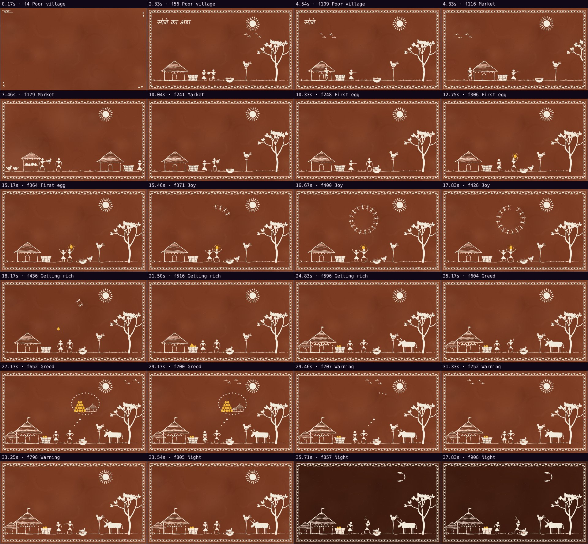
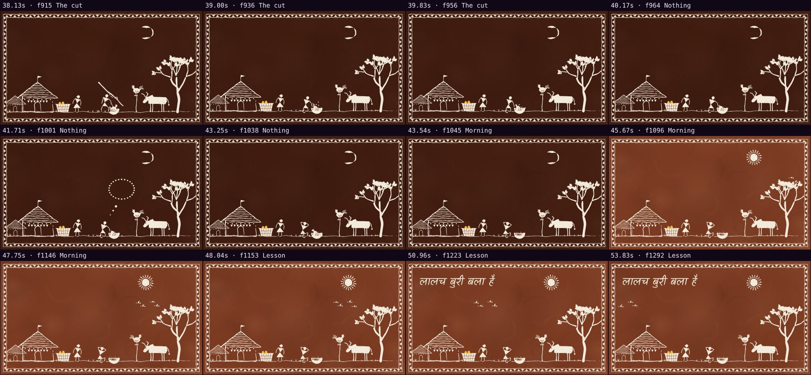

# Automatic review · sandbox/2026-11-11-sone-ka-anda/scene.js

960×540 px · 24 fps · 54.00 s · 1296 frames

## Warnings

- None.

## Motion

Energy per second (how much the image changes):

```
▄▂▁▁▅▄▁▁▄▆▂▁▂▁▁▂▂▃▇█▇▅▂▁▁▁▁▁▁▂▁▁▁▅▁▁▁▃▄▁▁▁▁▅▁▁▁▁▁▁▁▁▁▁
0    5    10   15   20   25   30   35   40   45   50   
```

Still stretches of 1 s or more (intended? a visual pause that looks like a glitch is a bug): 36.83 s–37.83 s, 38.83 s–41.00 s, 42.17 s–43.33 s, 44.17 s–45.17 s.

## Speed

Painting: 33 ms/frame cold, 21 ms warm → full render ≈ 27 s at this size.

## Contact sheet



