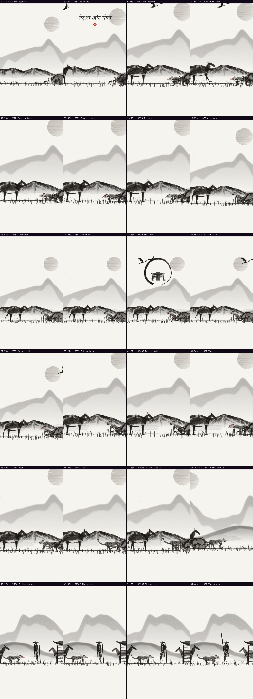
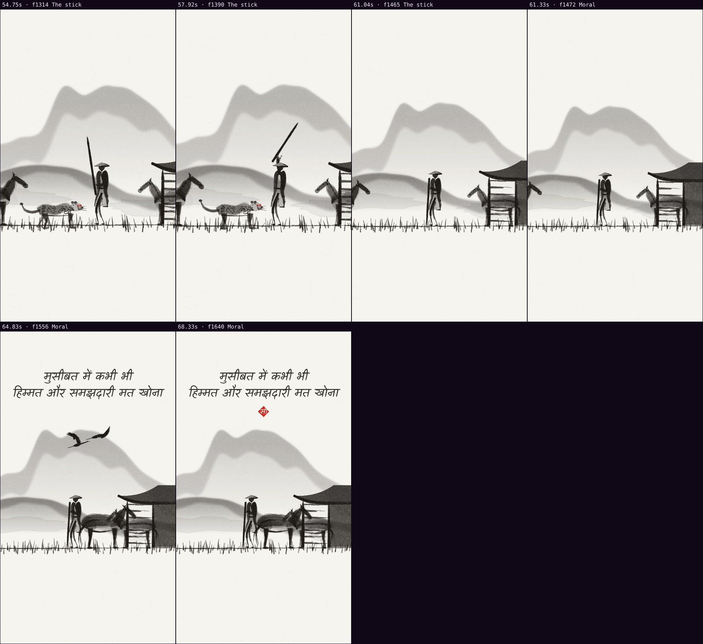

# Automatic review · sandbox/2026-11-11-tendua-aur-ghoda/scene.js

960×1707 px · 24 fps · 68.50 s · 1644 frames

## Warnings

- None.

## Motion

Energy per second (how much the image changes):

```
▁▂▃▄▄▄▂▃▃▂▂▂▂▁▁▁▂▃▄▅▅▄▃▂▂▁▂▂▂▂▂▃▆▃▁▁▁▁▁▁▁▁▃▂▂▆█▇▆▂▂▂▂▃▂▂▁▂▅▅▆▄▄▄▃▂▂▂▁
0    5    10   15   20   25   30   35   40   45   50   55   60   65   
```

Still stretches of 1 s or more (intended? a visual pause that looks like a glitch is a bug): 14.17 s–15.17 s, 37.50 s–39.00 s, 39.17 s–40.50 s.

## Speed

Painting: 387 ms/frame cold, 133 ms warm → full render ≈ 218 s at this size.

## Contact sheet



