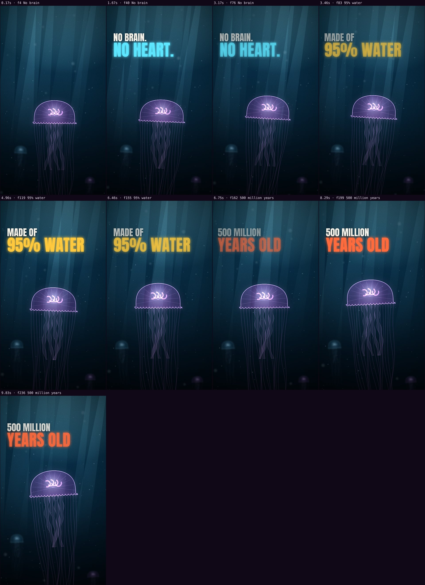

# Automatic review · sandbox/2026-11-12-jellyfish/scene.js

960×1707 px · 24 fps · 10.00 s · 240 frames

## Warnings

- None.

## Motion

Energy per second (how much the image changes):

```
▇▅▅█▅▆█▅▆▆
0    5    
```

No still stretches of 1 s or more.

## Speed

Painting: 2201 ms/frame cold, 3176 ms warm → full render ≈ 762 s at this size.

> Slow: cache static elements with `Motion.sprite` and lower the texture density.

## Contact sheet


