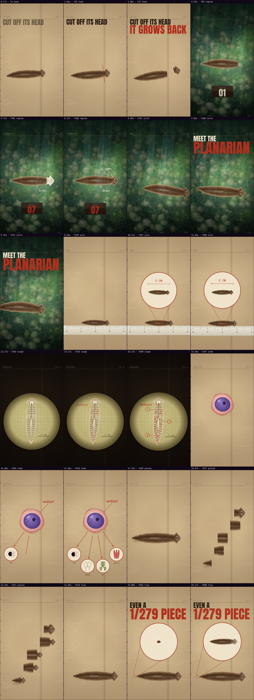
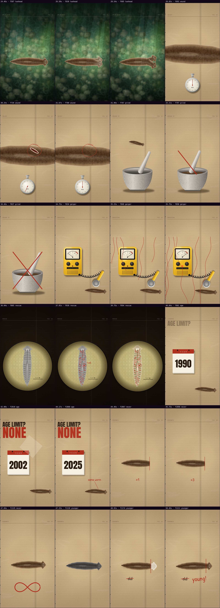
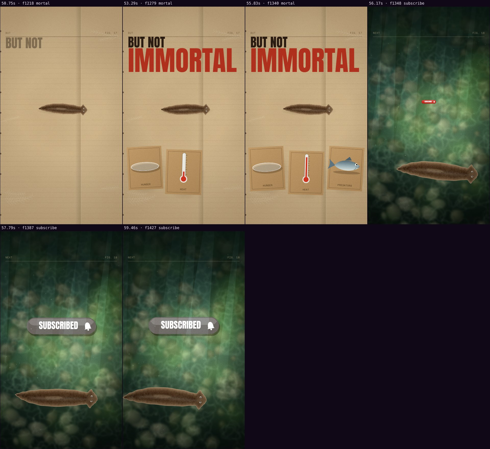

# Automatic review · sandbox/2026-11-12-planaria/scene.js

960×1707 px · 24 fps · 59.60 s · 1430 frames

## Warnings

- None.

## Motion

Energy per second (how much the image changes):

```
▁▂▇▂▂▂█▂▂▇▃▄▆▂█▁▂▄▃▁▁▂▃▁▇▂▂▂▆▁▁▅▂▂▄▇▃▁▁▇▂▃▃▂▅▁▁▂▁▁▄▂▁▁▁▃▇▂▂▂
0    5    10   15   20   25   30   35   40   45   50   55   
```

Still stretches of 1 s or more (intended? a visual pause that looks like a glitch is a bug): 44.50 s–45.67 s, 51.17 s–52.33 s, 54.33 s–55.83 s.

## Speed

Painting: 2423 ms/frame cold, 22 ms warm → full render ≈ 32 s at this size.

## Contact sheet




