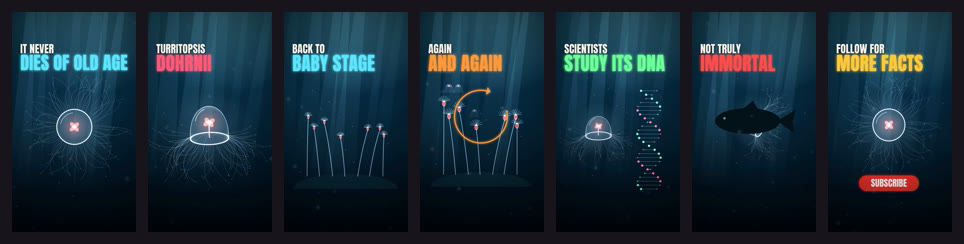

# Cinematic facts



The documentary-explainer look of fact Shorts: a deep, graded scene, light shafts, particles
drifting in depth of field, bold condensed two-line captions (a small white line over a big
glowing coloured one), slow push-ins, vignette and film grain.

**Status:** in testing · **Skill:** [`style-cinematic-facts`](../../.claude/skills/style-cinematic-facts/SKILL.md)

## Start a video in this style

```bash
node engine/new.mjs my-facts --style cinematic-facts --aspect 9:16 --duration 30
npm run preview    # http://127.0.0.1:5173
```

## Files

| File | What it gives |
|---|---|
| `template.js` | a sea, light shafts, particles and one caption |
| `cinema.js` | `Cine`: sea, rays, particles, blurred layers, photo cutouts, captions, vignette, grain |

## Made with it

- [immortal-jellyfish](../../sandbox/2026-11-12-immortal-jellyfish/) · Turritopsis dohrnii, 49 s, Hindi voice-over · [mp4](../../sandbox/2026-11-12-immortal-jellyfish/render/immortal-jellyfish.mp4)
- [jellyfish](../../sandbox/2026-11-12-jellyfish/) · the first test, 10 s · [mp4](../../sandbox/2026-11-12-jellyfish/render/jellyfish.mp4)
