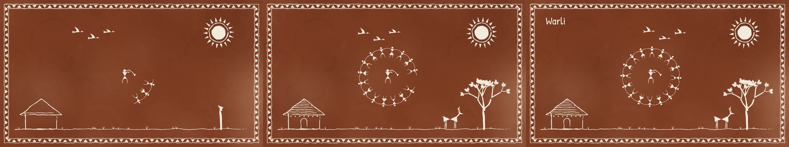

# Warli



The tribal wall painting of the Warli people of the Sahyadri hills in Maharashtra, India:
white rice paste on a red-brown mud wall. People are two triangles meeting at the waist,
with a round head and stick limbs. The sun is a disc in a ring of rays, and a hut is a
square under a hatched roof. At the centre of a village is the tarpa dance: a ring of people
holding hands, turning around the horn player.

**Status:** in testing · **Skill:** [`style-warli`](../../.claude/skills/style-warli/SKILL.md) (the rules and the checklist that keep every video in the style consistent)

## Start a video in this style

```bash
node engine/new.mjs my-test --style warli --duration 6
npm run preview    # http://127.0.0.1:5173
```

`template.js` is the minimal scene `new.mjs` copies.

## Files

| File | What it gives |
|---|---|
| `template.js` | a village wall painting itself: border, sun, hut, tree, deer, birds and the tarpa ring joining one by one |
| `warli.js` | `Warli`: paste strokes and fills, people with poses, the tarpa ring and player, sun, moon, tree, hut, bird, deer, ground, chowk border, mud wall, grain |

## Made with it

- [meri-video](../../sandbox/2026-11-11-meri-video/) · a car hits the village tree, 10 s · [mp4](../../sandbox/2026-11-11-meri-video/render/meri-video.mp4)
- [sone-ka-anda](../../sandbox/2026-11-11-sone-ka-anda/) · the golden egg, 54 s, Hindi voice-over · [mp4](../../sandbox/2026-11-11-sone-ka-anda/render/sone-ka-anda.mp4)
